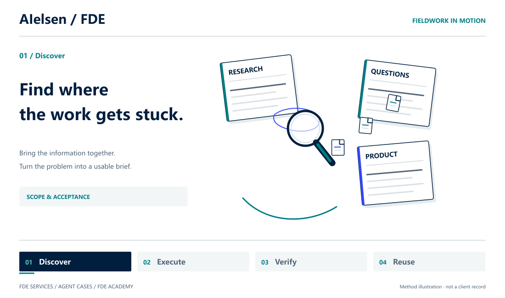
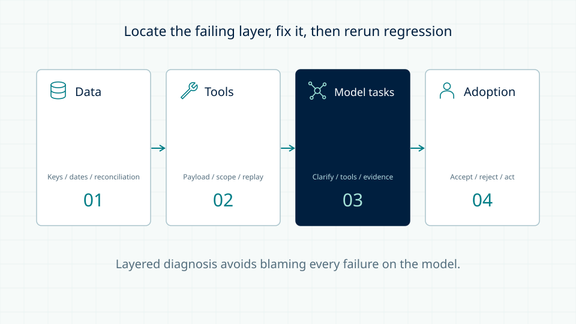
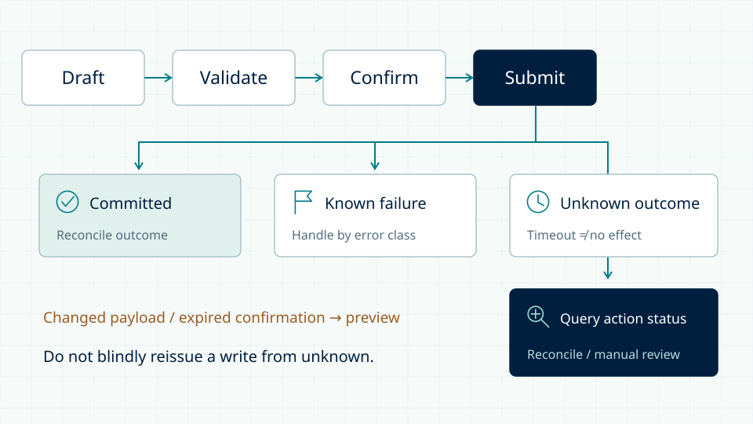

<p align="center"><a href="README.md">中文</a> · <strong>English</strong></p>
<h1 align="center">AIelsen FDE</h1>
<p align="center"><strong>From a business problem to AI work that can actually be delivered.</strong></p>
<p align="center">
  
  
  
  
</p>
<p align="center">
  <a href="https://fde.aielsen.com/en/">FDE services</a> ·
  <a href="https://fde.aielsen.com/en/playbook/">Find your use case</a> ·
  <a href="#see-an-agent-carry-the-work-through">Agent cases</a> ·
  <a href="#build-the-capability-to-deliver">FDE Academy</a> ·
  <a href="https://github.com/NewenergyEric/AIelsen-FDE-Toolkit/blob/main/README.en.md">FDE Toolkit</a>
</p>
<p align="center"></p>
<p align="center"><sub>18 seconds of continuous motion · 20 FPS / 360 frames · Silent loop · <a href="docs/media/fde-motion-en.png">Static version</a> · <a href="docs/studio/README.md">Animation source and production notes</a></sub></p>

A Forward Deployed Engineer has to solve more than whether a model can answer. **Unclear requirements, fragmented knowledge, broken handoffs and untestable outputs** are often the real obstacles to putting AI into enterprise work.

This repository connects our delivery approach, engineering practice and anonymized Agent cases. It shows both where AI may be useful and what actually happens between a request and a usable deliverable.

> **Complete website:** [`feat/agent-cases-20260910`](https://github.com/NewenergyEric/FDE-web/tree/feat/agent-cases-20260910) includes services, Academy and Agent cases. This update to `main` changes repository presentation only; it does not merge or deploy the website. [Deployment agents: start here](https://github.com/NewenergyEric/FDE-web/blob/feat/agent-cases-20260910/DEPLOY-AGENT-CASES.md).

## Find your starting point

| Your task | Start here | What you get |
| --- | --- | --- |
| Find a valuable business application | [Business Playbook](https://fde.aielsen.com/en/playbook/) | 9 plays and 66 in-context More applications: problems, inputs, methods, outputs and pilot evaluation |
| See how an agent carries work forward | [9 Agent cases](https://github.com/NewenergyEric/FDE-web/blob/feat/agent-cases-20260910/agent-cases/README.md) | Business context, key decisions, successive actions, deliverables, comparisons and worksheets |
| Train engineers to deliver | [FDE Academy](https://github.com/NewenergyEric/FDE-web/tree/feat/agent-cases-20260910/academy) | A 12-week curriculum, detailed notes, visual boards, interactive labs and engineering practice |
| Organize reusable skills for a team | [AIelsen FDE Toolkit](https://github.com/NewenergyEric/AIelsen-FDE-Toolkit/blob/main/README.en.md) | 539 adapted catalog records, 8 starter skill bundles, 2 delivery recipes and worked outputs |
| Take over and release the website | [Combined deployment guide](https://github.com/NewenergyEric/FDE-web/blob/feat/agent-cases-20260910/DEPLOY-AGENT-CASES.md) | Explicit branch, build commands, output directory, routes and acceptance checks |

**The services, Academy and case modules have implementation code. The Toolkit now has its own repository, starter bundles and limited synthetic-trial records. Both repositories are private and require authorized access. Host UI import has not been tested.**

## See an agent carry the work through

### Bella: from requirements, research and FAB to campaign copy and TVC

The case does not start with the final image. It follows clarification, research, feedback, FAB development, campaign planning, copy, creative direction and storyboards, then compares earlier recommendations with the final public film. The emphasis is **an agent participating across the campaign workflow**, not treating a similar frame as proof of overall business impact.

[Browse the case collection and maintenance guide →](https://github.com/NewenergyEric/FDE-web/blob/feat/agent-cases-20260910/agent-cases/README.md)

| Case | Starting problem | Work carried forward | What the page explains |
| --- | --- | --- | --- |
| **Ruby · Creator partnerships** | A product needs relevant overseas creators | Channel selection → individual pitch → reply handling → commercial handoff | Why this creator, which collaboration angle, what happens next |
| **Oliva · Product and after-sales support** | Information exists, but staff still have to hunt for it | Retrieve knowledge → draft in context → human correction → knowledge feedback | Answer grounding, service boundaries and how corrections improve the knowledge base |
| **Steve · Engineering handoff** | Documentation and implemented analysis rules may differ | Inspect rules → identify discrepancies → mark unverified points → prepare handoff | What is supported, what needs testing and how the next engineer continues |
| **Velia, Atlas, Nora, Leo and Iris** | Further marketing, product and business workflows | Scope follows the actual deliverables of each case | Problem framing, decisions, successive actions and usable outputs |

The collection contains **20 Chinese/English pages, 28 bilingual diagrams and 18 editable worksheets**. Names are aliases. Method illustrations, scene artwork and genuine comparisons are distinguished on the pages. Deliverables are not sales or ROI evidence.

## Build the capability to deliver

| Training stage | Key decisions | Required outputs |
| --- | --- | --- |
| **W01–03 · Frame the problem** | Is it worth doing? Who decides? What is in scope? | Project brief, fact ledger, metric contract and scope |
| **W04–06 · Connect the workflow** | Can the data support the decision? Are semantics and tool boundaries clear? | Adapters, data-quality report, ontology, tools and safety tests |
| **W07–09 · Engineer delivery** | Where did it fail? What if a write has an unknown outcome? Who handles incidents? | Evaluation set, connectors, execution trace and runbook |
| **W10–12 · Accept and reuse** | How should results be interpreted? What transfers to another project? | Acceptance evidence, retrospective, layered asset inventory and capstone |

| Agent evaluation: locate the failing layer | Actions: a timeout does not mean nothing happened |
| --- | --- |
| [](docs/media/evals-en.svg) | [](docs/media/states-en.svg) |

The Academy includes **100 detailed Chinese lessons, 19 bilingual cases and exercises, 24 bilingual boards and 6 interactive labs**, plus 30 concepts, 57 case-linked assignments and offline Python practice. Counts describe learning content, not customers. **Expanded notes are currently Chinese**; English pages provide curriculum summaries, cases, boards and practice guidance.

[Lesson notes](https://github.com/NewenergyEric/FDE-web/tree/feat/agent-cases-20260910/academy/content/notes) · [Engineering practice kit](https://github.com/NewenergyEric/FDE-web/tree/feat/agent-cases-20260910/academy/practice-kit) · [Training brochure PDF](https://github.com/NewenergyEric/FDE-web/blob/feat/agent-cases-20260910/academy/public/downloads/AIelsen-FDE-Academy-Brochure.pdf)

## FDE Toolkit: capabilities organized around the work

A useful toolkit answers three questions: **Where is the work stuck? Which capabilities belong together? What output establishes completion?**

Built on the existing WorkBuddy-adapted collection, the Toolkit uses six task entrances: discovery, product and marketing, knowledge and data, agent engineering, evaluation, and handoff. The catalog contains **539 records and 516 distinct operational bodies**. The first **8 bundles** include focused guidance, templates, synthetic inputs and complete worked outputs. Provenance, adaptation changes and tested scope are recorded separately; catalog size is not a tested-capability count.

| Delivery recipe | Connected capabilities | Concrete outputs |
| --- | --- | --- |
| [Product and creator partnerships](https://github.com/NewenergyEric/AIelsen-FDE-Toolkit/blob/main/recipes/creator-partnerships.en.md) | Research → alternatives → FAB and campaign → creator selection → pitch and reply handoff | Evidence brief, 15-second storyboard, individual pitch and commercial handoff |
| [Requirement to engineering handoff](https://github.com/NewenergyEric/AIelsen-FDE-Toolkit/blob/main/recipes/engineering-handoff.en.md) | Capability contract → consequential decisions → operating procedure | State and interface requirements, ADR and exception-handling rules |

[Open the Toolkit →](https://github.com/NewenergyEric/AIelsen-FDE-Toolkit/blob/main/README.en.md) · [Download bundles](https://github.com/NewenergyEric/AIelsen-FDE-Toolkit/releases) · [Verification scope](https://github.com/NewenergyEric/AIelsen-FDE-Toolkit/blob/main/docs/verification.md) · [Toolkit / website separation](https://github.com/NewenergyEric/FDE-web/blob/feat/agent-cases-20260910/DEPLOY-TOOLKIT.md)

The original [selection proposal](docs/FDE-TOOLKIT.en.md) remains an archive. Use the independent repository for current packages. At the owner's direction, the Toolkit stays off the business website: its navigation, homepage section and footer entry have been withdrawn. It is maintained in the separate GitHub repository only.

## Run the complete version locally

Use **Node.js 24.19+**. This repository is private; cloning requires authorized GitHub access.

```sh
git clone --branch feat/agent-cases-20260910 https://github.com/NewenergyEric/FDE-web.git
cd FDE-web
npm ci
npm run check
npm run build
npm test
npm run preview
```

Preview: `http://127.0.0.1:4179`. One build; the only publish directory is `dist/client/`.

| Area | Chinese | English |
| --- | --- | --- |
| Services | `/zh/` | `/en/` |
| Process / Playbook | `/zh/process/` · `/zh/playbook/` | `/en/process/` · `/en/playbook/` |
| Academy | `/academy/zh/` | `/academy/en/` |
| Agent cases | `/agent-cases/` | `/agent-cases/en/` |

Do not overwrite the domain root with the standalone cases module or publish source/`dist/server`. Preserve business CTAs, 9 plays, all 66 More applications, language switching and genuine 404 responses. [Deployment checklist](https://github.com/NewenergyEric/FDE-web/blob/feat/agent-cases-20260910/DEPLOY-AGENT-CASES.md) · [CI runs](https://github.com/NewenergyEric/FDE-web/actions?query=branch%3Afeat%2Fagent-cases-20260910)

## Use and maintenance boundaries

- This is a services, training and case-study website, not a hosted production agent platform. It does not offer learner accounts, cloud learning records or certification.
- Original customer files, working-agent identities, internal paths and secrets are not included. Public references do not imply partnerships or endorsement.
- Original course material, copy and design **have not been granted an open-source license**. Dependencies, fonts and any future community skills retain their respective licenses.
- The comic illustrates a method. Repository presentation changes do not alter website content, colors or runtime dependencies.

[Contributing](CONTRIBUTING.md) · [Content notes](CONTENT-NOTES.md) · [Asset notes](ASSETS.md) · [Showcase maintenance](docs/studio/README.md)
