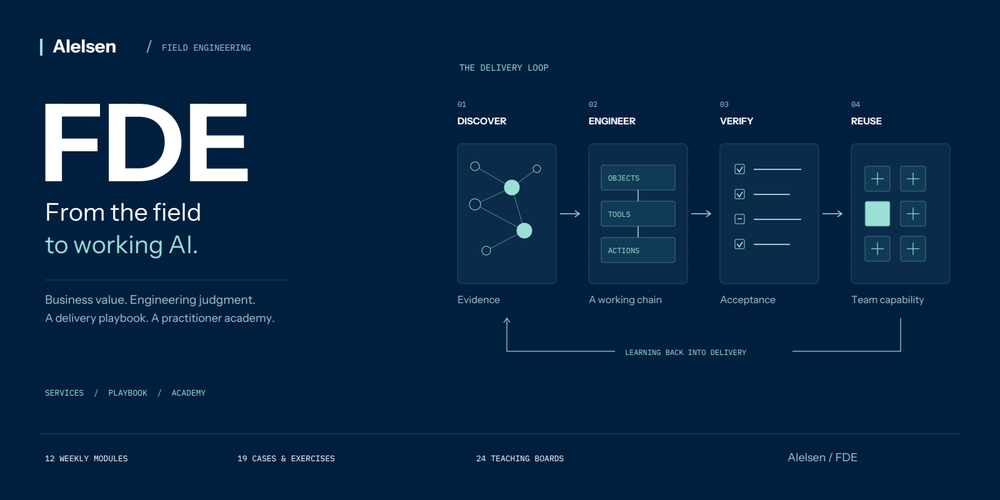

<p align="center">
  
</p>

<p align="center">
  <a href="README.md">中文</a> · <strong>English</strong><br>
  <a href="https://fde.aielsen.com/en/">FDE services</a> ·
  <a href="agent-cases/README.md">Agent case studies</a> ·
  <a href="academy">Academy source</a> ·
  <a href="DEPLOY-AGENT-CASES.md">Combined deployment guide</a> ·
  <a href="https://github.com/NewenergyEric/FDE-web/actions/workflows/verify.yml?query=branch%3Afeat%2Fagent-cases-20260910">Build checks</a>
</p>

# AIelsen FDE

**Understand the work. Engineer the system. Build the team's delivery capability.**

A Forward Deployed Engineer does more than make a model answer questions. The job is to understand the operating context, define meaningful measures, connect data and tools, and deliver something that stands up to both business and engineering review.

This project connects **FDE services and an enterprise Playbook**, **FDE Academy** and **Agent case studies**. Services explain what is worth building; the Academy develops delivery skills; the cases trace how a brief becomes decisions, working outputs and a usable handoff.

> **Complete edition:** services, Academy and Agent cases are integrated on [`feat/agent-cases-20260910`](https://github.com/NewenergyEric/FDE-web/tree/feat/agent-cases-20260910). The branch retains the complete Academy and adds a bilingual “Agent Cases” navigation entry. Code delivery does not mean production deployment; an older `main` checkout does not include this complete edition. Follow the [combined deployment guide](DEPLOY-AGENT-CASES.md).

## Find your starting point

| Audience | What you need to answer | Start here |
| --- | --- | --- |
| Business leaders | Which AI applications belong in real work? How should a pilot be scoped and accepted? | [Enterprise Playbook](https://fde.aielsen.com/en/playbook/) · [Delivery process](https://fde.aielsen.com/en/process/) |
| FDEs, AI and data engineers | How do discovery, data, agents, evaluation and production delivery fit together? | [Course source](academy/content) · [Engineering practice kit](academy/practice-kit) |
| Solutions leads and training organizers | How do we develop independent delivery capability, beyond tool familiarity? | [Training brochure (Chinese)](academy/public/downloads/AIelsen-FDE-Academy-Brochure.pdf) · [Academy guide](academy/README.md) |
| Developers and deployment agents | How do we maintain, verify and release an additive update? | [Deployment checklist](DEPLOY-AGENT-CASES.md) · [Contribution guide](CONTRIBUTING.md) |

## See the work in nine Agent cases

Each anonymized case includes a full Chinese and English narrative, scenario photography, working diagrams and an editable workbook. Follow **business problem → key decisions → continuous work → deliverables → before / after → reusable methods**.

| Case | Work to explore |
| --- | --- |
| Bella · Integrated marketing | Brief, research and FAB through campaign copy, storyboards and TVC comparisons |
| Ruby · Creator partnerships | Channel selection, personalized family-gaming pitches, replies and business handoff |
| Oliva · Product and after-sales support | Source material and customer context become reviewable drafts and maintained knowledge |
| Steve · Engineering handoff | Compare an advertising tool's documented rules with its actual behavior and open questions |

Velia, Atlas, Nora, Leo and Iris complete the collection. [Explore the case source and maintenance guide](agent-cases/README.md). The collection has 20 pages, 28 localized diagrams and 18 workbooks. Names are public aliases; illustrative scenes are distinct from original comparison evidence. Deliverables are not sales or ROI claims.

## The service and learning foundations

| FDE services & Playbook | FDE Academy |
| --- | --- |
| **Start with business value** | **Learn through the delivery lifecycle** |
| 6 delivery stages with concrete work and outputs | 12 weekly modules; 100 detailed lecture sections in Chinese |
| 9 core plays with 66 contextual applications inside each play's More tab | 19 bilingual studies: 9 public cases + 10 synthetic field exercises |
| Business question → inputs → method → output → pilot evaluation | 24 bilingual teaching boards; 6 interactive browser labs |
| Market entry, prospecting, creator partnerships, content, frontline service, business analysis, inventory planning, intelligence and knowledge reuse | 30 concepts; 22 primary readings; 16 editable worksheets per language |
| Separate Process / Playbook reference PDFs and editable pilot briefs | 57 case-linked assignments; an offline Python kit; a 12-page training brochure |

These are content counts, not customer counts, deployment counts or performance promises. Pages, cases and boards are bilingual. **The 100 expanded lecture sections are currently Chinese**; English modules provide overviews and workshops.

## A delivery curriculum, not just a topic list

The course follows a synthetic operating problem: from member engagement and data reconciliation to an advisory agent, bounded actions, production acceptance and reusable assets.

| Phase | Decisions to make | Work to produce |
| --- | --- | --- |
| **W01–03 · Frame the work** | Is this worth doing? Who decides? Are metrics and scope explicit? | Qualification brief, evidence ledger, metric contract, scope statement |
| **W04–06 · Build the chain** | Does the data support the decision? Are semantics consistent? Where do boundaries belong? | Adapter, quality report, ontology and tools, security tests |
| **W07–09 · Engineer delivery** | Where did it fail? What if an action's result is unknown? Who handles production incidents? | Evaluation dataset and runner, action connector, execution traces, runbook |
| **W10–12 · Accept and reuse** | How should outcomes be interpreted? Which changes are tenant-specific? | Acceptance evidence, retrospective, layered asset register, capstone |

### Inside the teaching boards

These are actual course diagrams, not product mockups. Click either image to inspect the full-size board.

| Evaluation: locate the failure | Actions: a timeout is not a failed write |
| --- | --- |
| [](docs/media/evals-en.svg) | [](docs/media/states-en.svg) |
| **W07:** passing one layer does not establish that the others work. | **W08:** distinguish outcomes, reconcile unknowns, then decide whether to retry. |

### How the cases work

Every study follows **problem → discovery → actions → key decisions → worked example → module assignments → acceptance → reusable assets**.

Aviation operations introduce business objects and integration boundaries. Enterprise knowledge applications lead into retrieval and layered evaluation. Service assistants raise questions about task resolution and escalation. Field exercises extend into market and account research, campaign review, business analysis, service and knowledge feedback.

Reported public context retains its sources; teaching inferences are labeled separately. Exercise data is synthetic, not private customer records. [Explore case content](academy/content) · [Training brochure (Chinese)](academy/public/downloads/AIelsen-FDE-Academy-Brochure.pdf)

## Run the complete edition locally

Use **Node.js 24.19+** and npm. Clone into a new directory rather than overwriting an existing working tree.

```sh
git clone --branch feat/agent-cases-20260910 https://github.com/NewenergyEric/FDE-web.git
cd FDE-web
npm ci
npm run check
npm run build
npm test
npm run preview
```

The repository is currently private; cloning requires access. Preview at `http://127.0.0.1:4179`.

| Experience | Chinese path | English path |
| --- | --- | --- |
| Services | `/zh/` | `/en/` |
| Delivery process | `/zh/process/` | `/en/process/` |
| Enterprise Playbook | `/zh/playbook/` | `/en/playbook/` |
| Academy | `/academy/zh/` | `/academy/en/` |
| Agent case studies | `/agent-cases/` | `/agent-cases/en/` |
| Curriculum / cases / resources | `/academy/zh/curriculum/` · `/academy/zh/cases/` · `/academy/zh/resources/` | The same paths under `/academy/en/` |

For development: `npm run dev -- --host 127.0.0.1 --port 4178`. Restart dev after editing Academy source; validate the combined static build before release.

## For maintainers and deployment agents

- **One build, one publish directory: `dist/client`.** The Academy is additive under `/academy/`, with separate styles and browser scripts. Preserve the existing business CTAs, 9 plays and 66 More applications.
- Before a production build, set `SITE_URL` to the HTTPS origin without `/academy`. Deep links must resolve directly. Unknown paths must return a real HTTP 404, not a catch-all SPA homepage.
- Stack: React / TypeScript / Vinext for the service site; native JavaScript static generation for the Academy. The website needs no model keys, database or backend. Python is only for offline practice and optional PDF maintenance.
- Automated checks cover authored content, internal links, language fields, diagrams and static output. Visual, keyboard and live-host acceptance remain explicit release steps.

[Deployment and acceptance](DEPLOY-AGENT-CASES.md) · [Static hosting contract](DEPLOYMENT.md) · [Academy editing map](academy/README.md) · [Contribution guide](CONTRIBUTING.md)

## Use and boundaries

This is a service and engineering-training website, not a production agent platform, hosted LMS or accreditation service. Learning progress and notes stay in the current browser.

Private client material and original research files do not belong in the repository. Public case references do not imply partnerships or endorsements. Service layers describe a modular delivery approach, not a promise that every module is already a purchasable standard product.

**No open-source license has been granted** to the original curriculum, copy or design. Third-party dependencies and fonts retain their respective licenses. [Editorial boundaries](CONTENT-NOTES.md) · [Asset provenance](ASSETS.md)
