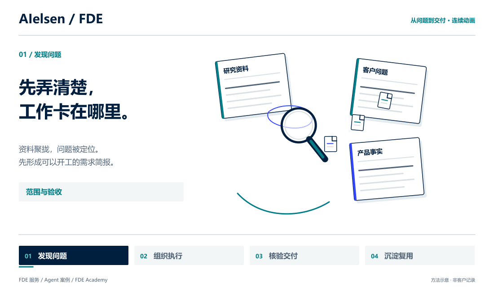
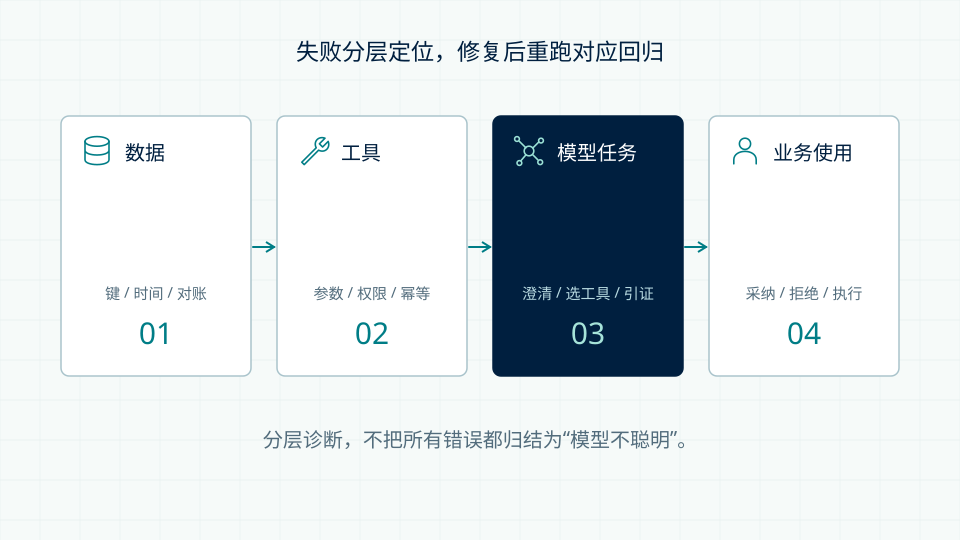
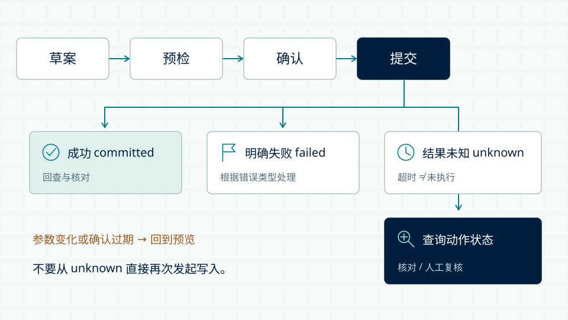

<p align="center">
  <strong>中文</strong> · <a href="README.en.md">English</a>
</p>

<h1 align="center">Enterprise AI Playbook</h1>
<p align="center"><strong>AIelsen · 企业 AI 应用、Agent 案例与 FDE 交付方法。</strong></p>

<p align="center">
  
  
  
  
</p>

<p align="center">
  <a href="https://fde.aielsen.com/zh/">了解 FDE 服务</a> ·
  <a href="https://fde.aielsen.com/zh/playbook/">寻找业务切入点</a> ·
  <a href="#先看-agent-如何把一件事做完">看 Agent 案例</a> ·
  <a href="#把交付方法练成团队能力">学习 FDE</a> ·
  <a href="LICENSING.md">使用许可</a> · <a href="SECURITY.md">安全说明</a>
</p>

<p align="center">
  
</p>
<p align="center"><sub>18 秒连续动画 · 20 FPS / 360 帧 · 无声循环 · <a href="docs/media/fde-motion-zh.png">查看静态版</a> · <a href="docs/studio/README.md">动效源码与制作说明</a></sub></p>

FDE（Forward Deployed Engineer，前线部署工程师）要解决的，不只是模型能不能回答。**需求说不清、知识散落、工作交接断层、产出无法验收**，往往才是 AI 进入企业的真正难点。

这里把我们的交付方法、工程训练和匿名 Agent 案例放在一起：你既能看到值得做什么，也能看清从需求到产物之间，具体做了哪些工作。

> **获取完整网站：** [`feat/agent-cases-20260910`](https://github.com/NewenergyEric/enterprise-ai-playbook/tree/feat/agent-cases-20260910) 包含服务站、学院和案例集。`main` 保留服务站及仓库入口，完整学院和案例代码仍在上述集成分支。此次安全更新不合并产品模块、不部署线上网站。[部署 Agent 请从这里开始](https://github.com/NewenergyEric/enterprise-ai-playbook/blob/feat/agent-cases-20260910/DEPLOY-AGENT-CASES.md)。

## 30 秒找到你的入口

| 你现在想做什么 | 打开什么 | 可以得到什么 |
| --- | --- | --- |
| 找到 AI 能切入的业务环节 | [业务 Playbook](https://fde.aielsen.com/zh/playbook/) | 9 类场景、66 个 More 应用，从痛点看到输入、方法、产出与试点评估 |
| 看清 Agent 如何持续完成工作 | [9 个 Agent 案例](https://github.com/NewenergyEric/enterprise-ai-playbook/blob/feat/agent-cases-20260910/agent-cases/README.md) | 业务问题、关键判断、连续行动、交付物、前后变化与工作表 |
| 训练能够独立交付的 FDE | [FDE Academy](https://github.com/NewenergyEric/enterprise-ai-playbook/tree/feat/agent-cases-20260910/academy) | 12 周课程、详细讲义、可视化画板、交互实验与工程实训 |
| 接手、验证并增量发布网站 | [完整部署指南](https://github.com/NewenergyEric/enterprise-ai-playbook/blob/feat/agent-cases-20260910/DEPLOY-AGENT-CASES.md) | 明确分支、构建命令、发布目录、路由和回滚验收点 |

**本仓库开放交付方法、课程与案例的源文件，供学习和非生产评估。生产使用、收费培训/咨询交付、转售或 SaaS 须取得书面商业授权。** [许可边界](LICENSING.md) · [商业授权](COMMERCIAL.md)

## 先看 Agent 如何把一件事做完

### Bella：从需求、研究与 FAB，一路做到文案与 TVC

不是只展示最后一张图。案例展开需求澄清、研究、沟通反馈、FAB 提炼、全案策划、文案、创意与分镜，再把前期建议与最终公开成片做具体对照。重点是 **Agent 如何贯穿全案工作**，而不是把某个画面相似当作完整成效证明。

[查看 Bella 所在案例集与维护说明 →](https://github.com/NewenergyEric/enterprise-ai-playbook/blob/feat/agent-cases-20260910/agent-cases/README.md)

| 案例 | 工作从哪里开始 | Agent 做到哪里 | 页面里看什么 |
| --- | --- | --- | --- |
| **Ruby · 海外创作者合作** | 产品需要找到合适的内容创作者 | 频道筛选 → 个性化 pitch → 回复处理 → 商务交接 | 为什么选这个人、怎样写合作切口、如何推进下一步 |
| **Oliva · 产品与售后客服** | 资料已经存在，客服却仍需到处翻找 | 知识检索 → 结合客户问题拟答 → 人工修订 → 知识反馈 | 答复依据、服务边界、返工如何回到知识库 |
| **Steve · 工程交接** | 文档与工具实际规则未必一致 | 核对分析规则 → 找到差异 → 标注待验证项 → 留下交接材料 | 哪个判断有依据、什么还需验证、下一位工程师如何继续 |
| **Velia、Atlas、Nora、Leo、Iris** | 更多营销、产品与业务工作 | 按各案实际交付范围展开 | 不同场景如何拆问题、组织行动与留下可用产物 |

九案共有 **20 个中英文页面、28 张双语图解、18 份可编辑工作表**。展示名是化名；方法图解、场景插画和真实前后对照在页面中分别说明。案例材料不等于销售业绩或 ROI 证明。

## 把交付方法练成团队能力

学院不是一份工具名词表，而是一条完整交付路径。

| 训练阶段 | 必须做出的判断 | 要交出的东西 |
| --- | --- | --- |
| **W01–03 · 判断问题** | 值不值得做？谁在做决定？如何界定范围？ | 项目判断书、事实账本、指标契约、范围说明 |
| **W04–06 · 建立链路** | 数据是否支持判断？业务语义和工具边界是否清楚？ | 数据适配器、质量报告、本体与工具、安全测试 |
| **W07–09 · 工程交付** | 失败在哪里？写入结果未知怎么办？谁来处理故障？ | 评估集、连接器、执行轨迹、运行手册 |
| **W10–12 · 验收复用** | 如何解释效果？哪些能力能带到下个项目？ | 验收证据包、复盘报告、分层资产清单、结业作品 |

| Agent 评估：失败应定位到哪一层？ | 执行动作：超时不等于没有执行 |
| --- | --- |
| [](docs/media/evals-zh.svg) | [](docs/media/states-zh.svg) |

课程包含 **100 节中文详细讲义、19 个双语案例与实作、24 张双语教学画板、6 个交互实验**，另有 30 个概念、57 项案例关联作业和离线 Python 实训。数字指内容规模，不是客户数量。**扩展讲义目前为中文**；英文版提供课程概要、案例、画板与实作指导。

[课程与讲义](https://github.com/NewenergyEric/enterprise-ai-playbook/tree/feat/agent-cases-20260910/academy/content/notes) · [工程实训包](https://github.com/NewenergyEric/enterprise-ai-playbook/tree/feat/agent-cases-20260910/academy/practice-kit) · [培训介绍 PDF](https://github.com/NewenergyEric/enterprise-ai-playbook/blob/feat/agent-cases-20260910/academy/public/downloads/AIelsen-FDE-Academy-Brochure.pdf)

## 公开范围与安全

这里是企业 AI 采用与工程交付的学习资料，不是可直接接入客户数据的生产平台。独立维护的私有工具包不在本仓库的公开和许可范围内。

[公开前安全审查](docs/security/PUBLICATION-REVIEW-2026-10-10.md)记录了历史、下载文件、依赖和自动化检查的覆盖范围。仍有一个上游未修复的构建期依赖风险（在 npm 中沿依赖链显示为 6 项高危），设有明确边界和到期复核；不声称“零风险”。[私密漏洞报告](SECURITY.md)

## 本地启动完整版本

使用 **Node.js 24.19+**。先阅读 [学习与非生产评估许可](LICENSING.md)，再获取相应分支。

```sh
git clone --branch feat/agent-cases-20260910 https://github.com/NewenergyEric/enterprise-ai-playbook.git
cd enterprise-ai-playbook
npm ci --ignore-scripts
npm run security:check
npm run security:audit
npm run check
npm run build
npm test
npm run preview
```

预览地址：`http://127.0.0.1:4179`。一次构建，唯一发布目录为 `dist/client/`。

| 内容 | 中文 | English |
| --- | --- | --- |
| 服务站 | `/zh/` | `/en/` |
| 流程 / Playbook | `/zh/process/` · `/zh/playbook/` | `/en/process/` · `/en/playbook/` |
| 学院 | `/academy/zh/` | `/academy/en/` |
| Agent 案例 | `/agent-cases/` | `/agent-cases/en/` |

部署不要用案例集覆盖域名根目录，不要发布源码或 `dist/server`。保留原业务 CTA、9 类场景、66 个 More 应用、中英文切换和真实 404。[完整验收清单](https://github.com/NewenergyEric/enterprise-ai-playbook/blob/feat/agent-cases-20260910/DEPLOY-AGENT-CASES.md) · [CI 运行记录](https://github.com/NewenergyEric/enterprise-ai-playbook/actions?query=branch%3Afeat%2Fagent-cases-20260910)

## 使用与维护边界

- 网站是服务介绍、工程培训和案例展示，不是已托管的生产 Agent 执行平台；没有学员账号、云端学习记录或认证服务。
- 原始客户资料、真实 Agent 身份、内部路径与密钥不进入仓库。公开引用不表示合作或背书。
- 原创内容采用 **AIelsen Learning and Evaluation License 1.0**，不是 MIT 或 OSI 开源许可；[第三方材料](THIRD_PARTY_NOTICES.md)保留自己的许可。
- 动效为原创方法示意。真实对照图片经所有者确认可随仓库公开，但仍可能被反向识别；不授予第三方素材的再次利用权。

[贡献与协作](CONTRIBUTING.md) · [内容规范](CONTENT-NOTES.md) · [素材说明](ASSETS.md) · [展示素材维护](docs/studio/README.md)
